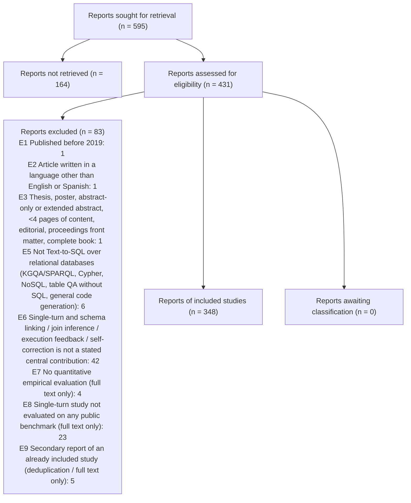

# PRISMA 2020 counts - full-text stage



```json
{
 "stage": "ft",
 "tool": "sr-screener 1.0.0",
 "complete": true,
 "pending_records": 0,
 "pending_ta_records": 0,
 "pending_ta_qc_records": 0,
 "fulltext_set_out_of_date": false,
 "state_problems": [],
 "reports_sought_for_retrieval": 595,
 "reports_not_retrieved": 164,
 "reports_assessed": 431,
 "reports_to_assess": 431,
 "reports_excluded": 83,
 "excluded_by_reason": {
  "E1 Published before 2019": 1,
  "E2 Article written in a language other than English or Spanish": 1,
  "E3 Thesis, poster, abstract-only or extended abstract, <4 pages of content, editorial, proceedings front matter, complete book": 1,
  "E5 Not Text-to-SQL over relational databases (KGQA/SPARQL, Cypher, NoSQL, table QA without SQL, general code generation)": 6,
  "E6 Single-turn and schema linking / join inference / execution feedback / self-correction is not a stated central contribution": 42,
  "E7 No quantitative empirical evaluation (full text only)": 4,
  "E8 Single-turn study not evaluated on any public benchmark (full text only)": 23,
  "E9 Secondary report of an already included study (deduplication / full text only)": 5
 },
 "reports_unclear_awaiting_classification": 0,
 "studies_included_reports": 348,
 "agreement": {
  "n": 431,
  "both_advance": 321,
  "both_exclude": 97,
  "a_only_advance": 7,
  "b_only_advance": 6,
  "observed_agreement": 0.9698,
  "kappa": 0.917,
  "pabak": 0.94
 },
 "decided_by": {
  "A+B": 377,
  "AJE": 42,
  "ADJ": 12
 }
}
```
