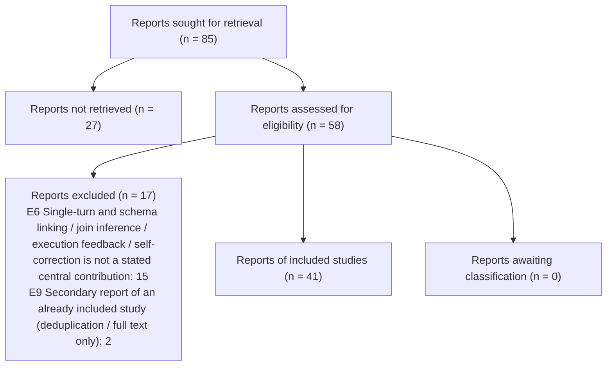

# PRISMA 2020 counts - full-text stage



```json
{
 "stage": "ft",
 "tool": "sr-screener 1.0.0",
 "complete": true,
 "pending_records": 0,
 "pending_ta_records": 0,
 "pending_ta_qc_records": 0,
 "fulltext_set_out_of_date": false,
 "state_problems": [],
 "reports_sought_for_retrieval": 85,
 "reports_not_retrieved": 27,
 "reports_assessed": 58,
 "reports_to_assess": 58,
 "reports_excluded": 17,
 "excluded_by_reason": {
  "E6 Single-turn and schema linking / join inference / execution feedback / self-correction is not a stated central contribution": 15,
  "E9 Secondary report of an already included study (deduplication / full text only)": 2
 },
 "reports_unclear_awaiting_classification": 0,
 "studies_included_reports": 41,
 "agreement": {
  "n": 58,
  "both_advance": 39,
  "both_exclude": 15,
  "a_only_advance": 4,
  "b_only_advance": 0,
  "observed_agreement": 0.931,
  "kappa": 0.835,
  "pabak": 0.862
 },
 "decided_by": {
  "A+B": 52,
  "AJE": 2,
  "ADJ": 4
 }
}
```
