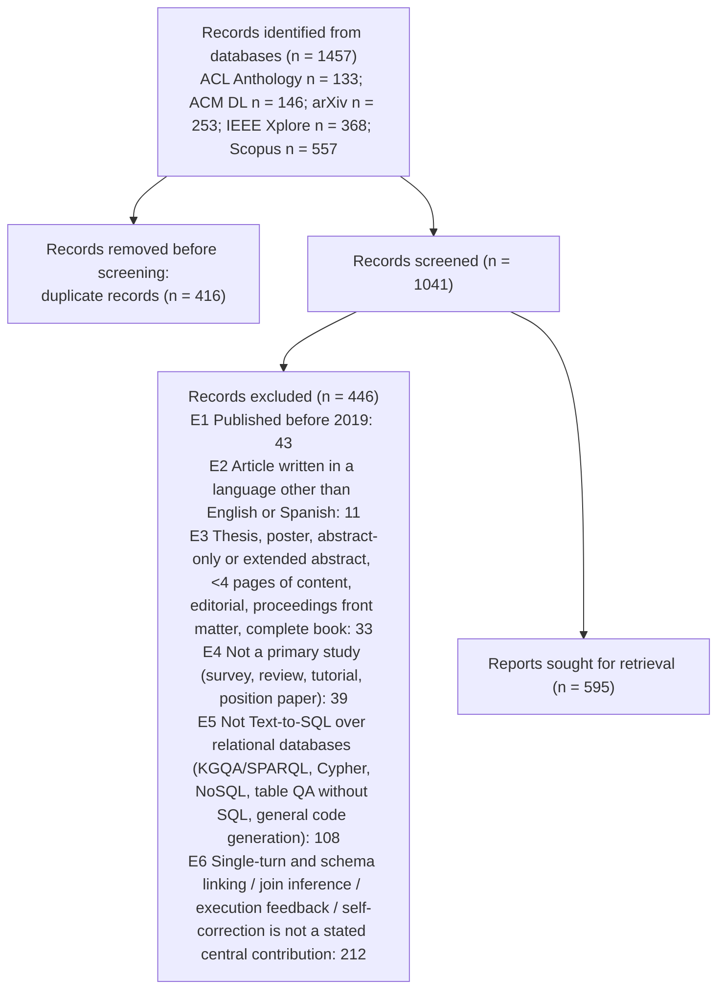

# PRISMA 2020 counts - title/abstract stage



```json
{
 "stage": "ta",
 "tool": "sr-screener 1.0.0",
 "complete": true,
 "pending_records": 0,
 "state_problems": [],
 "identified_by_database": {
  "ACL Anthology": 133,
  "ACM DL": 146,
  "arXiv": 253,
  "IEEE Xplore": 368,
  "Scopus": 557
 },
 "identified_total": 1457,
 "duplicates_removed": 416,
 "records_screened": 1041,
 "records_to_screen": 1041,
 "records_excluded": 446,
 "excluded_by_code": {
  "E1": 43,
  "E2": 11,
  "E3": 33,
  "E4": 39,
  "E5": 108,
  "E6": 212
 },
 "reports_sought_for_retrieval": 595,
 "advanced_include": 343,
 "advanced_unclear": 252,
 "advanced_outside_allowed_languages": 0,
 "agreement": {
  "n": 1041,
  "both_advance": 532,
  "both_exclude": 477,
  "a_only_advance": 12,
  "b_only_advance": 20,
  "observed_agreement": 0.9693,
  "kappa": 0.938,
  "pabak": 0.939,
  "conflicts": 32,
  "resolved_by": {
   "AJE": 69,
   "A+B": 972
  }
 },
 "decided_by": {
  "AJE": 69,
  "A+B": 972
 }
}
```
