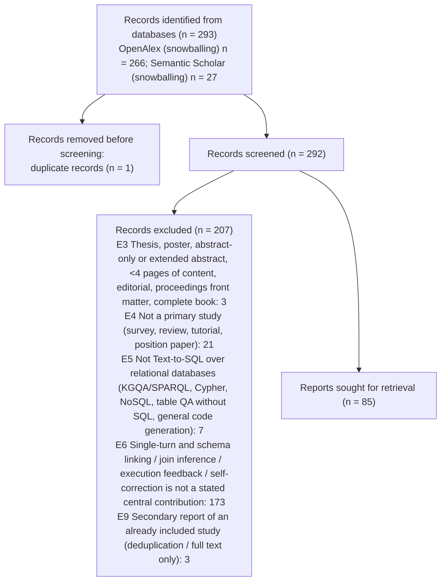

# PRISMA 2020 counts - title/abstract stage



```json
{
 "stage": "ta",
 "tool": "sr-screener 1.0.0",
 "complete": true,
 "pending_records": 0,
 "state_problems": [],
 "identified_by_database": {
  "OpenAlex (snowballing)": 266,
  "Semantic Scholar (snowballing)": 27
 },
 "identified_total": 293,
 "duplicates_removed": 1,
 "records_screened": 292,
 "records_to_screen": 292,
 "records_excluded": 207,
 "excluded_by_code": {
  "E3": 3,
  "E4": 21,
  "E5": 7,
  "E6": 173,
  "E9": 3
 },
 "reports_sought_for_retrieval": 85,
 "advanced_include": 23,
 "advanced_unclear": 62,
 "advanced_outside_allowed_languages": 0,
 "agreement": {
  "n": 292,
  "both_advance": 63,
  "both_exclude": 212,
  "a_only_advance": 6,
  "b_only_advance": 11,
  "observed_agreement": 0.9418,
  "kappa": 0.843,
  "pabak": 0.884,
  "conflicts": 17,
  "resolved_by": {
   "A+B": 260,
   "AJE": 29,
   "dedup": 3
  }
 },
 "decided_by": {
  "A+B": 260,
  "AJE": 29,
  "dedup": 3
 }
}
```
